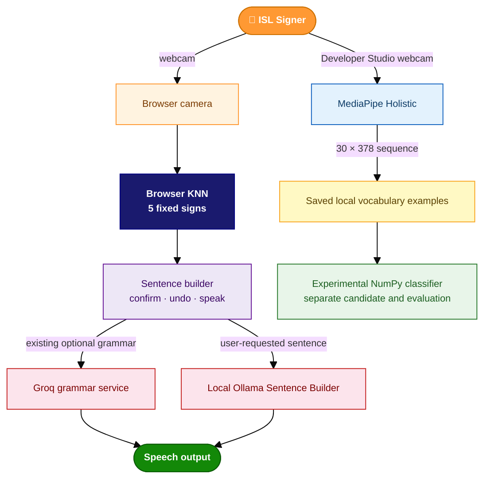

# 🤟 Real Time Indic Sign Language to Speech Translator

> Bridging the communication gap for the **Deaf and Hard-of-Hearing community** by translating **Indian Sign Language (ISL)** gestures into spoken sentences — in real time, across **7 Indian languages**, using just a webcam.


---

## 🌟 Overview

Indian Sign Language is the primary mode of communication for millions of Deaf and Hard-of-Hearing individuals across India, yet very few real-time tools exist to bridge the gap between ISL users and non-signers. This project addresses that gap.

The project has two separate recognition paths. The main web demo uses a browser-side KNN image classifier for five fixed signs. Developer Studio records MediaPipe Holistic landmarks as 30-frame × 378-feature sequences for the experimental expandable classifier. A legacy Flask camera path can use the optional BiLSTM model. The AI Sentence Builder is a separate, optional Ollama feature that forms an English sentence from a reviewed sequence; it does not change sign predictions. The existing sentence workflow and optional Groq grammar refinement remain separate.

---

## 🔄 System Architecture & Pipeline



---

## ✨ Key Features

| Feature | Description |
|---|---|
| 🎯 **ISL Sign Recognition** | Browser KNN recognizes five fixed signs; the legacy model and scripts cover a wider vocabulary |
| 🗣 **7 Indian Languages** | English, Hindi, Bengali, Tamil, Telugu, Marathi, Gujarati |
| ⚡ **Real-Time Recognition** | Browser KNN and experimental sequence recognition; legacy server-side MediaPipe remains optional |
| 🧠 **Legacy BiLSTM** | Optional Keras model captures forward and backward gesture motion |
| 🗳 **Prediction Stability** | Legacy server mode uses 4/6 frame agreement; browser KNN confirms over multiple frames |
| ✍️ **AI Grammar Correction** | Groq LLaMA 3.1 converts ISL gloss into natural sentences |
| 🔄 **Rule-Based Fallback** | Works fully offline if Groq API is unavailable |
| ✍️ **AI Sentence Builder** | Optional local Ollama sentence suggestion from reviewed, stable sign predictions |
| 🌐 **Browser UI** | Live MJPEG camera stream, no plugins needed |
| 🔊 **Multilingual TTS** | Speaks final sentence in the user's chosen language |

---

## 🗂️ Project Structure

```
Real-Time-Indic-Sign-Language-to-Speech-Translator/
├── app.py                          # Flask backend — camera loop, inference, MJPEG stream
├── requirements.txt                # Python dependencies
├── .env.example                    # Environment variable template
├── package.json / package-lock.json # Browser classifier build dependencies
├── knn-recognizer.js               # Browser classifier source
├── Frontend/
│   ├── index.html                  # Main translator UI
│   ├── app.js                      # Browser KNN, sequence review, and sentence UI
│   ├── styles.css                  # Main translator styles
│   ├── knn-recognizer.bundle.js    # Checked-in browser classifier runtime
│   ├── sequence-accumulator.js     # Shared sequence review logic
│   └── developer.*                # Developer Studio UI and styles
├── scripts/
│   ├── expandable_classifier.py    # Candidate training, evaluation, and listing
│   ├── vocabulary_store.py         # Local vocabulary and session storage
│   ├── sequence_contract.py        # Versioned landmark feature contract
│   ├── capture_validation.py       # Capture quality checks
│   ├── ai_sentence_builder.py      # Optional local Ollama integration
│   ├── sentence_builder.py         # Standalone OpenCV desktop sentence builder
│   ├── word_tester.py              # Test all 50 signs with reference video panel
│   ├── personal_collector.py       # Record your own ISL training data via webcam
│   ├── data_collection.py          # Extract landmarks from raw dataset videos
│   ├── video_processor.py          # Video preprocessing utilities
│   ├── model_training.py           # Train BiLSTM on INCLUDE dataset features
│   ├── train_personal_only.py      # Train BiLSTM on personal recordings only
│   ├── augment_personal_data.py    # Augment recordings with noise/scaling
│   ├── fine_tune.py                # Fine-tune INCLUDE model on personal data
│   └── evaluation_report.py        # Per-class accuracy evaluation
├── tests/                          # Python and browser sequence tests
├── models/
│   └── isl_model_solo.keras        # Legacy BiLSTM model
├── mediapipe_models/
│   ├── holistic_landmarker.task    # MediaPipe Holistic runtime asset
│   └── *.tflite                    # Distributed MediaPipe component assets
├── data/
│   └── extracted_features/         # Empty label folders; local samples are ignored
├── tests/                          # Python and browser sequence tests
└── experimental/
    └── yolov8/                     # Optional isolated detection experiment
```

---

## ⚙️ Installation

### Windows setup (PowerShell)

- 64-bit Python 3.11, available as `py -3.11`
- A working webcam

1. Download the repository ZIP from GitHub (**Code → Download ZIP**) and extract it.
2. Open PowerShell in the extracted `Real-Time-Indic-Sign-Language-to-Speech-Translator` folder (the one containing `app.py` and `requirements.txt`).
3. Create a fresh environment and install the project dependencies. This does not use or require the repository owner's local environment:

```powershell
py -3.11 -m venv .venv
.\.venv\Scripts\python.exe -m pip install --upgrade pip
.\.venv\Scripts\python.exe -m pip install -r requirements.txt
```

4. Start the website:

```powershell
.\.venv\Scripts\python.exe app.py
```

Open **`http://localhost:5000`** in Chrome or Firefox. Developer Studio is at **`http://localhost:5000/developer`**. The checked-in browser bundle is used, so Node.js/npm and separate dataset downloads are not required for the main web demo.

### Optional API key

Groq grammar refinement is optional. To configure it, copy the example file and add your own key to the local `.env`:

```powershell
Copy-Item .env.example .env
```

Then edit `.env`:

```
GROQ_API_KEY=your_groq_api_key_here
```

Get a key at [console.groq.com](https://console.groq.com). The main web demo works without it; `.env` is ignored by Git and must not be shared. The local browser KNN recognizer does not require a Groq key.

### Optional local AI Sentence Builder

The website's AI Sentence Builder calls Ollama through Flask and sends only the reviewed sign labels, uncalibrated raw confidence scores, uncertainty flags, and the selected recognizer's supported vocabulary. It does not send webcam frames or landmarks. The feature is optional; the KNN and experimental recognizers remain usable when Ollama is unavailable.

1. Install Ollama from [ollama.com](https://ollama.com) and start its local service.
2. Download the default lightweight model once:

   ```powershell
   ollama pull qwen2.5:3b
   ```

3. Optionally set `ISL_OLLAMA_BASE_URL`, `ISL_OLLAMA_MODEL`, and `ISL_OLLAMA_TIMEOUT_SECONDS` in `.env`. Defaults are `http://127.0.0.1:11434`, `qwen2.5:3b`, and 45 seconds.
4. Restart Flask and use the website's **AI Sentence Builder**. Choose the recognizer, collect and inspect its stable signs, edit or remove labels as needed, and press **Finish Sentence**. AI corrections are suggestions, not verified signs; the original sequence is retained for comparison.

The local model may be unavailable or return an invalid response; in either case the interface reports an error without disabling recognition. This feature is an experimental limited-vocabulary sentence aid, not continuous or complete ISL translation.

---

## 🚀 Running the Project

### Option A — Web App (Recommended)

The Windows setup above starts the Flask app, which serves the frontend; no separate frontend server is required. The Python dependencies are listed in `requirements.txt`; the separate YOLOv8 experiment uses its own environment. For the browser KNN recognizer:

1. Click **Start Camera** and wait for the browser recognizer model to load.
2. Perform each sign and click its matching training button: **Hello**, **Thank You**, **Sorry**, **Yes**, and **No**. Each completed training run collects 30 webcam examples for that class and saves them in this browser.
3. Click **Start Recognition** after all five classes have examples. Recognition requires at least 5 examples for each sign and confirms a sign over multiple frames.
4. Recognized words are added to the existing **Building Sentence** flow; use **Confirm**, **Clear**, **Undo**, language selection, and **Speak** as usual.

Training data is restored from IndexedDB when the page is reopened. Use **Save Training Data** to save the currently loaded examples, **Export Data** to download a portable JSON backup, **Import Data** to restore a backup, or **Clear Training Data** to remove the saved and loaded examples (confirmation required). The backup contains the original 227×227 PNG examples and class labels, not internal classifier tensors.

The browser KNN learns only from examples you collect; it is not a pretrained ISL sign model. The reserved `OTHER` class is not trainable and is never added to the sentence; low-confidence or non-sign predictions are rejected. Its camera and classifier run in the browser and do not use the Python Keras model. Do not use the browser and Flask camera paths at the same time.

The current five isolated-word classes do not encode grammar or support arbitrary sentence translation. The sentence builder preserves the original recognized-word sequence, removes only consecutive duplicate words from finalized display text, and uses existing grammar correction only for broader vocabulary sequences when its output preserves every recognized token and only adds limited linking words. Add useful ISL vocabulary next for pronouns and subjects, common action verbs (such as want, need, go, eat, and drink), question words, negation, time, places, and frequently signed objects.

### Main website — sequence review

The **AI Sentence Builder** is separate from the existing sentence controls. Choose **Browser KNN** or a current active validated sequence model, start the shared browser camera once, then use **Start sequence**. Stable sign predictions are collected in order; pause, undo, remove, correct, or clear them before selecting **Finish Sentence**. That sends one reviewed sequence to the configured local Ollama model. The original predictions stay visible, and any AI interpretation or recognition correction is a suggestion—not a verified translation. If Ollama is unavailable, recognition and the existing sentence workflow remain usable.

The main page refreshes saved vocabulary and active-model state on load, on return to the tab, and periodically while open. The translator uses only a validated active model whose complete label map and training-data fingerprint match the current saved data. Candidates are not selectable for live inference. Newly saved examples are not learned automatically: training a candidate, evaluating it on independent sessions, and activating it are distinct explicit steps managed in Developer Studio. The active sequence classifier predicts individual signs from successive 30-frame windows; it is not a continuous sign-language model. Browser KNN remains a separate five-sign fallback.

The Flask development server binds to `127.0.0.1`; the app is available on this computer at `http://localhost:5000`.

### Developer Studio — record vocabulary

Open **`http://localhost:5000/developer`** while the Flask app is running. Create or resume a word in either **Shared** or **Personal** scope, enable the camera, capture a complete 30-frame sequence, review it, then save accepted examples. To record independent examples for the same word, select **Start New Session** before capturing; existing examples stay in their original sessions. The interface shows the active session and sample count. Shared and personal records are stored separately.

Saved vocabulary, session manifests, and landmark arrays live under `data/vocabulary_drafts/`. They are local files and are ignored by Git. The scopes are storage categories on this computer, not a team sync service. GitHub does not synchronize runtime vocabulary between teammates. Share data only through a separately approved, access-controlled export or storage mechanism.

Creating a vocabulary word does not add it to the fixed browser KNN classes. Use the Training Lab in Developer Studio to train a separate candidate from saved examples. Activation requires a complete current vocabulary map, an unchanged training-data fingerprint, compatible preprocessing, and a complete session-separated confusion report. The translator refreshes the active state automatically; it never activates candidates by itself.

### Model files and local dependencies

The repository includes `models/isl_model_solo.keras` and the MediaPipe assets under `mediapipe_models/`; permission to distribute these assets has been confirmed by the project owner. Preserve their existing paths and filenames and the accompanying third-party attribution/model-card notices. The app supports `ISL_KERAS_MODEL_PATH` and `ISL_HOLISTIC_MODEL_PATH` in a local, ignored `.env` file for authorized external copies. `.env.example` contains only an API-key placeholder, default optional Ollama settings, and blank model-path settings; never put real credentials or private paths in tracked files.

The Keras file is used by the legacy Flask-side BiLSTM recognition path. If it is absent, Flask still serves the main website and browser KNN; the Flask camera recognition action reports that its model is unavailable. The MediaPipe `holistic_landmarker.task` file is required for Developer Studio capture, experimental live landmark capture, and the legacy Flask camera. The seven separate `.tflite` files are retained at their original paths as distributed MediaPipe assets; the current application calls the bundled Holistic task rather than loading those component files individually. Do not distribute any private recordings used for training.

### Option B — Desktop Script

A standalone OpenCV window — same pipeline, no browser needed.

```powershell
.\.venv\Scripts\python.exe scripts\sentence_builder.py
```

| Key | Action |
|---|---|
| `ENTER` | Finalise sentence and speak |
| `B` | Undo last word |
| `C` | Clear sentence |
| `1–7` | Switch language (En/Hi/Bn/Ta/Te/Mr/Gu) |
| `Q` | Quit |

### Option C — Word Tester

Test all 50 signs one by one with a reference video side-by-side.

```powershell
.\.venv\Scripts\python.exe scripts\word_tester.py
```

| Key | Action |
|---|---|
| `SPACE` | Mark sign as passed, move to next |
| `F` | Flag sign as failing, move to next |
| `Q` | Quit and print summary of flagged signs |

---

## 🧠 Experimental expandable classifier

The expandable classifier is an experimental CPU-only NumPy model. It is separate from the five-sign browser KNN and from the legacy BiLSTM; it does not require either model artifact. It trains on saved Developer Studio examples with the versioned `isl-holistic-30x378-v1` contract.

Use the shared or personal scope consistently. Each word needs at least **2 independent recording sessions** to participate in training. Session-separated evaluation requires at least **4 sessions per word**; with fewer sessions, the report marks evaluation insufficient rather than reusing training sessions. Keep separate unknown/background sessions if you want false-accept measurements.

From the project directory, train a new candidate without activating it:

```powershell
.venv\Scripts\python.exe scripts\expandable_classifier.py train --scope shared
.venv\Scripts\python.exe scripts\expandable_classifier.py list --scope shared
.venv\Scripts\python.exe scripts\expandable_classifier.py evaluate --scope shared --artifact-id <artifact-id>
```

Use `--scope personal` for personal examples. Training creates a new scoped artifact under the ignored vocabulary data directory; it does not overwrite the live browser KNN or the legacy BiLSTM. To activate a validated candidate, open **Developer Studio → Training Lab**, refresh the chosen scope, select the candidate, review its label coverage and held-out report, then activate it explicitly. The main translator will refresh the active state and use the same camera stream for sequence predictions. This experimental path is not evidence of signer-independent or continuous-sentence accuracy.

The candidate must pass its session-separated checks before the UI enables activation. Activation changes only that scope’s experimental-model pointer. It does not replace the browser KNN or the legacy BiLSTM.

## 🧠 Legacy BiLSTM training

The legacy BiLSTM scripts use a separate feature format and workflow; they are not required for the browser KNN or Developer Studio sequence classifier. `video_processor.py` extracts full-face features from source videos, `model_training.py` writes `models/isl_model.keras`, and `fine_tune.py` uses that generated base model plus personal feature arrays. `train_personal_only.py` writes `models/isl_model_solo.keras`, replacing the included legacy model at that path if run. Training is not required for the web demo. Since sign recognition is signer-dependent, results may not generalize to other signers or cameras.

The legacy data-preparation and training scripts expect source videos in `data/raw/` or extracted feature arrays in `data/extracted_features/`. Those datasets and personal recordings are not included in the repository. The folder placeholders alone are insufficient to train a model. `video_processor.py` requires the MediaPipe Holistic asset and `tqdm`; its generated landmark arrays are local data and ignored by Git.

```powershell
# Step 1 — Record 30 sequences per word via webcam
.\.venv\Scripts\python.exe scripts\personal_collector.py

# Step 2 — Augment to expand the dataset
.\.venv\Scripts\python.exe scripts\augment_personal_data.py

# Step 3 — Train the BiLSTM
.\.venv\Scripts\python.exe scripts\train_personal_only.py
```

The legacy training script writes to `models/isl_model_solo.keras`; do not run it while preserving the existing artifact. It is intentionally not part of the normal demo or the experimental expandable-classifier workflow.

## 🧪 YOLOv8 detection pilot

The separate YOLOv8 experiment is not connected to live translation. It requires the local dataset archive at the path documented by `experimental/yolov8/prepare_dataset.py`, a prepared dataset, and a verified checkpoint under the ignored `experimental/yolov8/weights/` directory. Follow `experimental/yolov8/SETUP-CPU.md` to create its isolated Python 3.11 CPU environment. Dataset preparation refuses to overwrite an existing output directory. The pilot runs one CPU epoch and writes reports/checkpoints under ignored experiment outputs; it is not a validated sign-language recognizer. The portable `pilot_data.yaml` uses a relative root that the pilot script resolves from its own directory.

## 🧪 Tests

Run the Python unit tests and browser sequence test from the project directory:

```powershell
.\.venv\Scripts\python.exe -m unittest discover -s tests -v
node --test tests\frontend_sequence.test.cjs
```

Node.js is required only for the frontend test or rebuilding the browser bundle; it is not needed to run the bundled web app. To rebuild the bundle from `knn-recognizer.js`, install the locked npm dependencies and run the build script:

```powershell
npm ci
npm run build:knn
```

---

## 📊 Supported Signs — 50 Classes

These labels belong to the legacy model/data workflows; the current browser KNN demo recognizes only **Hello**, **Thank You**, **Sorry**, **Yes**, and **No**.

| Category | Signs |
|---|---|
| **Pronouns** | I, You, He, She, They, We, It |
| **Family** | Mother, Father, Brother, Sister, Family, Friend |
| **Professions** | Teacher, Doctor, Police, Student, Man, Woman, Patient |
| **Emotions** | Happy, Sad, Good, Bad, Strong, Weak, Healthy, Sick, Alive |
| **Age** | Old, Young, Deaf |
| **Greetings** | Hello, How are you, Thank you, Good Morning |
| **Places** | House, Hospital, School |
| **Time** | Today, Tomorrow, Yesterday, Morning, Night, Time |
| **Others** | Exercise, Sign, Dream, Sport, Medicine |

---

## 📦 Dataset

The legacy BiLSTM artifact at `models/isl_model_solo.keras` is separate from the browser KNN and experimental expandable classifier. Its redistribution is authorized by the project owner. Personal webcam captures made through the project are not included in the repository and remain local.

The **[INCLUDE dataset](https://zenodo.org/record/4010759)** (4,292 clips, 263 word signs, IIT Madras · AI4Bharat) was used as a reference to select the 50 word classes covered by this project. It is not used for training and is not required to run the project.

---


## 🙏 Acknowledgements

- [INCLUDE Dataset](https://zenodo.org/record/4010759) — Indian Sign Language dataset by IIT Madras · AI4Bharat
- [MediaPipe](https://mediapipe.dev) — Holistic landmark extraction by Google
- [Groq](https://groq.com) — LLaMA 3.1 ultra-fast inference for grammar correction
- [gTTS](https://gtts.readthedocs.io) — Google Text-to-Speech multilingual audio
- [TensorFlow / Keras](https://tensorflow.org) — Deep learning framework

---

## 📄 Licensing status

This repository does not currently contain a project `LICENSE` file; no project-wide license is stated. The browser classifier bundle retains its embedded upstream license/copyright notices. MediaPipe assets and Python/JavaScript dependencies are third-party materials with their own terms; retain applicable notices and model-card attribution when redistributing them. The INCLUDE dataset is acknowledged as a reference and is not included or required to run the app.
